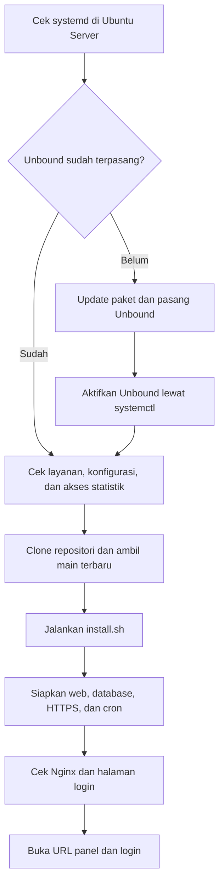
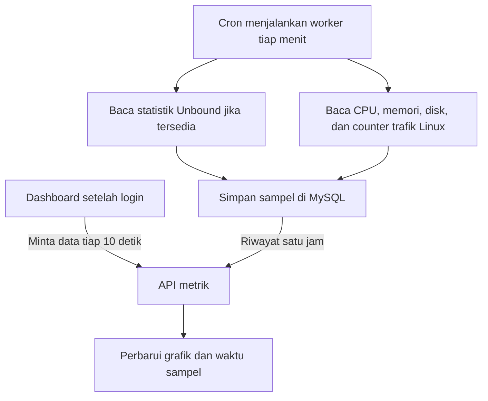
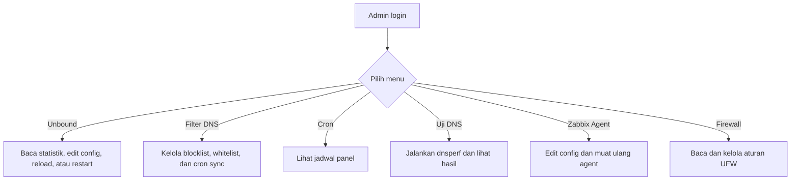

# Unbound Web Manager

Panel web untuk memantau resolver Unbound dan mengelola layanan di Ubuntu Server. Dari browser, kamu bisa lihat grafik DNS dan Linux, restart Unbound, edit konfigurasi, serta kelola filter DNS dan firewall.

## 1. Siapkan server DNS

Gunakan Ubuntu Server dengan akses `sudo`. Cek apakah systemd sudah berjalan sebagai proses utama.

```bash
ps -p 1 -o comm=
```

Hasilnya harus `systemd`. Kalau pakai Ubuntu di WSL 2 dan systemd belum aktif, tambahkan `systemd=true` di bagian `[boot]` pada `/etc/wsl.conf`. Jalankan `wsl --shutdown` dari PowerShell, buka Ubuntu lagi, lalu ulangi pengecekan. [Panduan systemd di WSL](https://learn.microsoft.com/en-us/windows/wsl/wsl-config#systemd-support)

Kalau Unbound belum terpasang, jalankan ini dari terminal Ubuntu.

```bash
sudo apt update && sudo apt upgrade && sudo apt install curl htop git unbound ufw iftop -y
```

Aktifkan layanan Unbound di systemd agar langsung jalan dan otomatis mulai saat server boot. [Referensi systemctl](https://manpages.ubuntu.com/manpages/noble/man1/systemctl.1.html)

```bash
sudo systemctl enable --now unbound
systemctl is-enabled unbound
```

Hasil yang diharapkan adalah `enabled`. Setelah itu, cek apakah layanan `active`, konfigurasi valid, dan statistik bisa dibaca. Kalau Unbound sudah terpasang dan aktif, mulai dari sini.

```bash
systemctl is-active unbound
sudo unbound-checkconf /etc/unbound/unbound.conf
sudo unbound-control -c /etc/unbound/unbound.conf stats_noreset
```

Kalau statistik belum muncul, cek bagian `remote-control` di konfigurasi Unbound. Akses kontrol cukup lewat socket lokal atau localhost. Grafik Linux tetap berjalan saat statistik DNS belum tersedia. [Panduan remote control Unbound](https://unbound.docs.nlnetlabs.nl/en/latest/getting-started/configuration.html#set-up-remote-control)

## 2. Pasang panel web

Jalankan di server Ubuntu yang akan dipantau. Clone branch `main` ke direktori home pengguna.

```bash
cd ~ && git clone --branch main https://github.com/ekiguistian/Unbound_DNS_Web-Manager.git
```

Masuk ke folder hasil clone, ambil versi terbaru dari `main`, lalu jalankan installer.

```bash
cd ~/Unbound_DNS_Web-Manager &&
git pull --ff-only origin main &&
sudo WEB_HOST=dns-panel.example.net bash install.sh
```

Ganti `dns-panel.example.net` dengan nama DNS atau IP server. Kalau `WEB_HOST` dikosongkan, installer mengambil alamat pertama dari `hostname -I`.

Installer menyiapkan MySQL, PHP 8.4-FPM, Nginx, cron, dan dnsperf. Jika PHP 8.4 belum ada di repositori aktif, installer menambahkan PPA `ondrej/php`. Aplikasi dipasang ke `/opt/www/unbound-web/` dan kredensial disimpan di `/etc/unbound-web/.env`.

Setelah migrasi database, installer menjalankan `nginx -t`, mengecek halaman login HTTPS, lalu menampilkan URL, username, dan password. Password login baru terdiri dari 8 karakter acak dengan 1 huruf kapital, 1 simbol, dan 6 huruf kecil. Installer memakai kredensial yang sudah ada saat dijalankan ulang.

Buka URL HTTPS yang muncul di terminal, login dengan akun tersebut, lalu buka **Monitor**. Tunggu sekitar dua menit agar worker mengumpulkan sampel untuk grafik QPS dan trafik.

Sertifikat awal bersifat self-signed. Cocokkan fingerprint SHA-256 di browser dengan hasil perintah ini sebelum mempercayai sertifikat.

```bash
sudo openssl x509 -in /etc/unbound-web/tls/panel.crt -noout -fingerprint -sha256
```

### Alur pemasangan



## 3. Update web app dari main

Gunakan folder hasil clone di `~/Unbound_DNS_Web-Manager`. Sebelum update, cadangkan database panel dan `/etc/unbound-web/`. Cek perubahan lokal di folder proyek.

```bash
cd ~/Unbound_DNS_Web-Manager && git status --short
```

Jika ada file yang berubah, simpan perubahan itu lewat commit atau stash sebelum melanjutkan. Setelah folder kerja bersih, jalankan rangkaian berikut. Ganti `WEB_HOST` dengan nama DNS atau IP yang dipakai panel saat ini.

```bash
cd ~/Unbound_DNS_Web-Manager &&
git switch main &&
git pull --ff-only origin main &&
sudo WEB_HOST=dns-panel.example.net bash install.sh
```

`git pull` memperbarui source di folder clone. Menjalankan kembali `install.sh` menerapkan versi itu ke `/opt/www/unbound-web/`, menjalankan migrasi database yang diperlukan, dan memuat ulang layanan web. Rangkaian berhenti jika salah satu perintah gagal. Kalau Git melaporkan riwayat branch berbeda, selesaikan perbedaan commit sebelum mengulang update.

Setelah installer selesai, buka kembali panel dan cek waktu sampel terakhir. Gunakan perintah ini untuk melihat commit source dan kondisi layanan web.

```bash
cd ~/Unbound_DNS_Web-Manager && git log -1 --oneline
sudo nginx -t
systemctl is-active nginx php8.4-fpm cron
```

## 4. Lihat monitoring

Setelah login, buka **Monitor**. Worker mengambil data tiap menit dan menyimpan riwayat di MySQL. Dashboard meminta data tiap 10 detik dan menampilkan riwayat satu jam. Kalau grafik berhenti bergerak, cek waktu sampel terakhir.

| Metrik | Cara baca |
|---|---|
| QPS | Jumlah kueri per detik. Angka muncul setelah ada dua sampel yang bisa dibandingkan. |
| Cache hit dan latensi | Persentase kueri yang dilayani dari cache dan rata-rata waktu rekursi dalam ms. |
| CPU, memori, dan disk | CPU dalam persen, memori terpakai dan total dalam MiB, serta disk untuk filesystem root dalam GiB. |
| Trafik jaringan | Pilih interface. RX adalah trafik masuk dan TX adalah trafik keluar. Panel memakai kbps di bawah 1.000 kbps dan Mbps mulai 1.000 kbps. |
| Info Linux | Hostname, distro, kernel, uptime, dan rata-rata load 1, 5, serta 15 menit. |

### Alur monitoring



## 5. Kelola layanan

| Menu | Fungsi |
|---|---|
| **Unbound** | Baca statistik, reload, restart, atau edit `/etc/unbound/unbound.conf`. Panel memvalidasi perubahan dengan `unbound-checkconf` sebelum memuat ulang layanan. Jika file berubah sejak dibuka, muat ulang editor sebelum menyimpan. |
| **Blocklist & whitelist** | Tambah URL sumber HTTPS dan domain pengecualian. Aktifkan filter lalu pilih **Terapkan & perbarui cron**. Sinkronisasi otomatis berjalan pukul 03.15 waktu server saat minimal satu filter aktif. Kamu juga bisa menjalankannya langsung dari panel. |
| **Cron** | Lihat jadwal panel. Worker monitoring berjalan tiap menit, termasuk saat filter dimatikan. |
| **Uji DNS** | Jalankan dnsperf ke resolver loopback atau jaringan privat yang kamu kelola. Atur domain, port, durasi, dan batas QPS. Hasilnya berisi jumlah kueri, jawaban, QPS, dan latensi. |
| **Zabbix Agent** | Edit konfigurasi Agent atau Agent 2 yang sudah terpasang. Panel memakai restart jika unit layanan hanya mendukung restart untuk memuat konfigurasi. |
| **Firewall** | Lihat status UFW, aktifkan, nonaktifkan, atau reload firewall. Kamu juga bisa tambah, edit, dan hapus aturan yang didukung. Pastikan aturan mengizinkan akses SSH dan HTTPS sebelum mengaktifkan UFW. |

Untuk filter DNS, pastikan `unbound.conf` memuat `/etc/unbound/unbound.conf.d/*.conf` lewat `include:` atau `include-toplevel:`. Panel memakai file `90-unbound-web-blocklist.conf` di direktori itu. Saat kedua filter dimatikan, panel menghapus aturan filter miliknya dan melepas cron sinkronisasi.

Pilihan UFW mencakup semua protokol, TCP, UDP, TCP+UDP, ICMP IPv4, dan beberapa protokol lain. Aturan ICMP yang dibuat lewat panel disimpan di `/etc/ufw/before.rules`. Aturan lanjutan dari server bisa tampil sebagai teks.

### Alur fungsi panel



## Cek kalau ada masalah

```bash
sudo nginx -t
systemctl status nginx php8.4-fpm cron unbound
sudo -u unbound-web /usr/bin/php8.4 /opt/www/unbound-web/bin/worker.php
sudo /usr/local/sbin/unbound-web-manage cron-view
```
