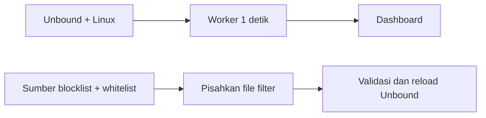
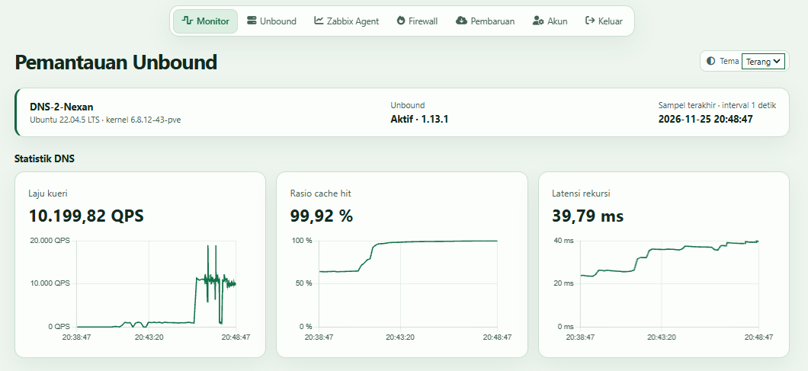

# Unbound Web Manager

Panel HTTPS untuk monitor dan kontrol Unbound di Ubuntu Server 22.04 LTS. Login diperlukan untuk membuka panel.

## Dependensi

- **Server**: Ubuntu 22.04 LTS, systemd, akses `sudo`, Unbound, dan akses ke APT serta GitHub.
- **Dipasang oleh installer**: Git, Nginx, MySQL 8, PHP 8.4 CLI/FPM dengan PDO MySQL, Python 3, OpenSSL, curl, rsync, cron, iproute2, dan dnsperf. Installer menambahkan PPA Ondřej jika paket PHP 8.4 belum tersedia.
- **Opsional**: `unbound-anchor` untuk mengelola trust anchor DNSSEC, UFW untuk menu Firewall, dan Zabbix Agent atau Agent 2 untuk ekspor metrik.

## Instalasi awal

Di server baru, siapkan Unbound terlebih dahulu:

```bash
sudo apt update &&
sudo apt install -y git unbound &&
sudo systemctl enable --now unbound &&
sudo unbound-checkconf /etc/unbound/unbound.conf
```

Gunakan [unbound.conf.example](unbound.conf.example) sebagai acuan. Sesuaikan IP, ACL, dan ukuran cache dengan server. Periksa file root hints, trust anchor, dan sertifikat kontrol yang dirujuk contoh sebelum menggunakannya. Aktifkan `remote-control` lokal agar panel bisa membaca statistik DNS.

```bash
cd ~ &&
git clone --branch main https://github.com/ekiguistian/Unbound_DNS_Web-Manager.git &&
cd Unbound_DNS_Web-Manager &&
sudo bash ./install.sh
```

Buka URL HTTPS dan login dengan akun yang ditampilkan installer. Akses panel memakai TCP 443. Untuk menentukan alamat sendiri, jalankan `sudo env WEB_HOST=dns.example.net bash ./install.sh`. Sertifikat HTTPS awal bersifat self-signed.

### Jika unduhan paket PHP gagal dengan HTTP 503

Jika PPA Ondřej mengembalikan `503 Service Unavailable` saat mengunduh paket PHP 8.4 dan installer berhenti dengan `exit 100`, jalankan kembali dari folder repo:

```bash
sudo apt-get update && sudo bash ./install.sh
```

Jika pesan `503` masih muncul, tunggu beberapa menit lalu ulangi perintah yang sama.

## Update dari main

Panel menghitung versi dari riwayat utama `main` mulai **1.0.30**. Setiap commit baru di jalur itu menambah angka terakhir versi satu kali. MySQL menyimpan versi, hash lengkap, serta waktu pengecekan dan pemasangan.

Buka **Pembaruan → Check for update**, periksa versi dan hash, lalu pilih **Pasang pembaruan**. Panel mengambil commit dari GitHub ke `/opt/www/unbound-web/.updates/` dan menjalankan `install.sh` melalui systemd. Jika gagal, cek `sudo journalctl -u unbound-web-update -n 50`.

Untuk memperbarui lewat terminal, jalankan dari folder repo dengan riwayat Git lengkap:

```bash
cd ~/Unbound_DNS_Web-Manager &&
git switch main &&
git pull --ff-only origin main &&
sudo bash ./install.sh
```

## Fitur

| Menu | Fungsi |
|---|---|
| **Monitor** | QPS, cache, latensi, CPU, RAM, disk, dan RX/TX. Dashboard diperbarui per detik dengan riwayat 10 menit. |
| **Unbound** | Cek, simpan, reload, start/stop, root hints, DNSSEC, dan sertifikat TLS remote-control. Perubahan konfigurasi yang berhasil disimpan ke file dan database. |
| **Live Log** | Baca 40 entri journal terakhir dan ikuti log baru. Log query dan reply punya toggle terpisah. **Stop** menghentikan sesi log. |
| **Cron / Uji DNS** | Lihat status monitoring dan jadwal filter. Jalankan satu pengujian dnsperf sekaligus ke IPv4 privat atau loopback, maksimal 16 client, 4 thread, dan 1.000 QPS. |
| **Zabbix Agent** | Edit konfigurasi agen atau aktifkan item `unbound.web.metrics` untuk total query, total reply, QPS, dan metrik Linux. Lihat [panduan item dan grafik Zabbix](docs/zabbix.md). |
| **Firewall** | Kelola rule, status, dan reload UFW. |

Tema **Sistem** mengikuti OS. Pilih **Terang** atau **Gelap** untuk menyimpan pilihan di browser.

Untuk produksi, batasi akses panel ke jaringan admin atau VPN dan izinkan kueri DNS hanya dari subnet klien. Lihat [panduan keamanan](SECURITY.md).

## Filter DNS

1. Tambahkan URL HTTPS publik di menu **Blocklist & Whitelist**. Isi file dapat berupa daftar domain, hosts, URL, Adblock, CSV, atau JSON. Tambahkan domain pengecualian secara manual atau isi URL whitelist.
2. Pilih **Masukkan Blocklist ke konfigurasi** atau **Masukkan Whitelist ke konfigurasi**. Tombol memasang include di dalam `server:` pada `/etc/unbound/unbound.conf`:

```conf
    include: "/etc/unbound/blocklist/blocklist.conf"
    include: "/etc/unbound/blocklist/whitelist.conf"
```

3. Setelah include aktif, tombol berubah untuk menghapus include dan menonaktifkan filter terkait. Konfigurasi dan pengaturan dicatat ke database. Sinkronisasi berjalan pukul 03.15 waktu server. Gunakan **Update & Apply Now** untuk sinkronisasi langsung.

Salin URL sumber yang ingin dipakai ke kolom filter terkait.

**Whitelist** · [Buka daftar domain Eki Guistian](https://raw.githubusercontent.com/ekiguistian/whitelist-host/refs/heads/main/whitelist-domain.txt)

```text
https://raw.githubusercontent.com/ekiguistian/whitelist-host/refs/heads/main/whitelist-domain.txt
```

**Blocklist** · [Buka daftar hosts StevenBlack](https://raw.githubusercontent.com/StevenBlack/hosts/master/alternates/fakenews-gambling-porn-social-only/hosts)

```text
https://raw.githubusercontent.com/StevenBlack/hosts/master/alternates/fakenews-gambling-porn-social-only/hosts
```

Hasil konversi ada di `/var/lib/unbound-web-filters/`. Log ada di `/var/log/unbound-web-filters.log`. Untuk daftar jutaan domain, sediakan RAM tambahan saat validasi dan reload.



## Screenshot

### Monitor




### Kontrol dan pembaruan


## Atribusi

System ini di buat dan hasil ide oleh Eki Guistian, Anda boleh memakai dan memodifikasi dengan syarat tetap membuka code ke public dan mencatumkan sumber dari Eki guistian. sesuai aturan opensource. Ketentuan lisensi repositori tercantum di [LICENSE](LICENSE), dan lisensi komponen eksternal tercantum di [THIRD-PARTY.txt](public/assets/THIRD-PARTY.txt).
