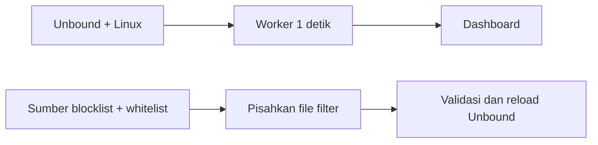
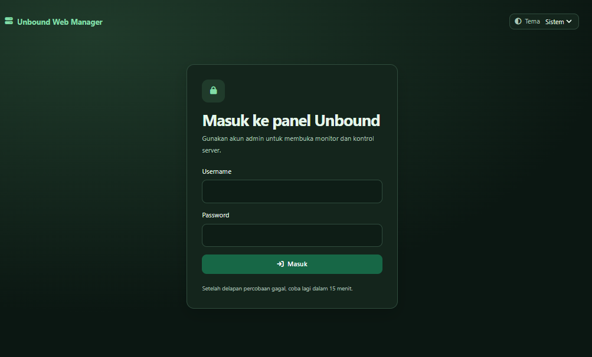
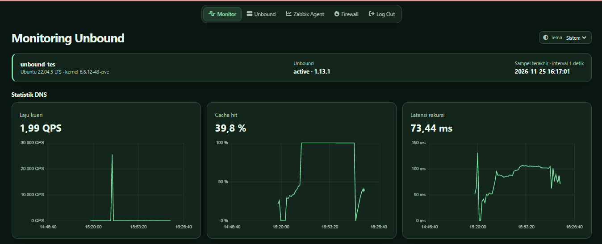
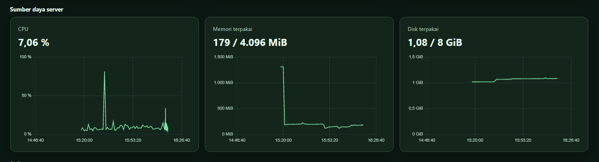
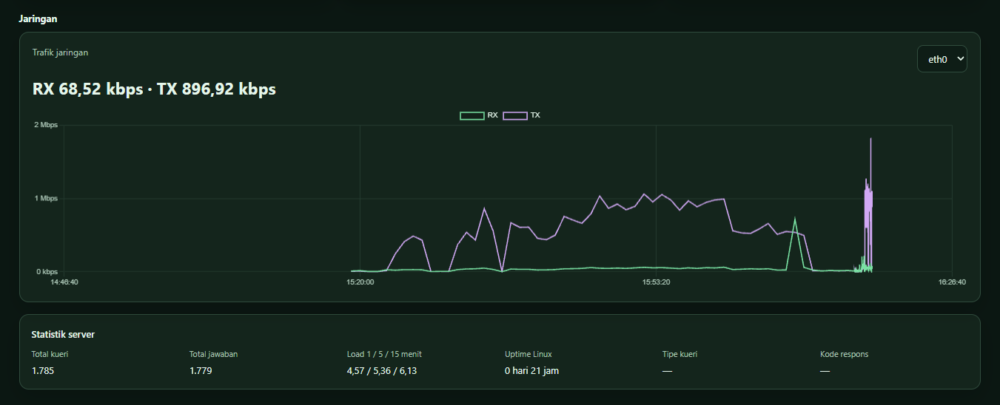
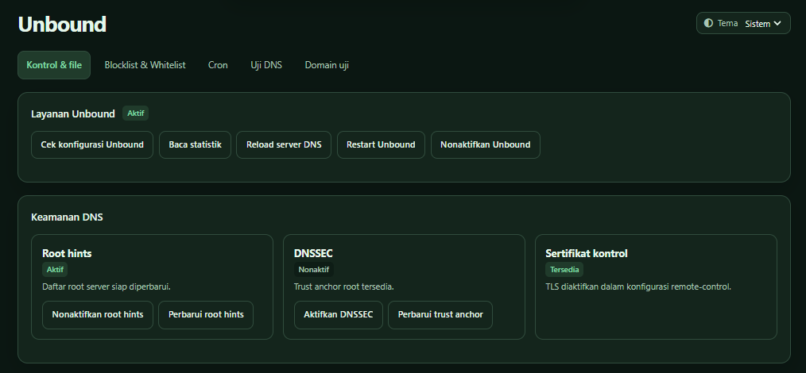
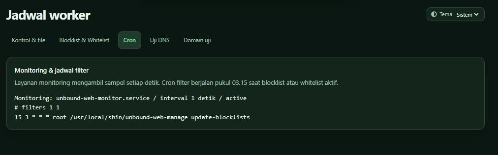

# Unbound Web Manager

Panel HTTPS untuk monitor dan kontrol Unbound di Ubuntu Server 22.04 LTS. Login diperlukan untuk membuka panel.

## Dependensi

- **Server**: Ubuntu 22.04 LTS, systemd, akses sudo, Unbound, Git, dan koneksi paket APT.
- **Dipasang oleh installer**: Nginx, MySQL 8, PHP 8.4 CLI/FPM dengan PDO MySQL, Python 3, OpenSSL, curl, rsync, cron, iproute2, dan dnsperf. PHP 8.4 diambil dari PPA Ondřej jika paket belum tersedia.
- **Opsional**: `unbound-anchor` untuk menyiapkan trust anchor DNSSEC, UFW untuk firewall, dan Zabbix Agent atau Agent 2 untuk menu Zabbix.

## Instalasi awal

Di server baru, siapkan Unbound terlebih dahulu:

```bash
sudo apt update &&
sudo apt install -y git unbound ufw &&
sudo systemctl enable --now unbound &&
sudo unbound-checkconf /etc/unbound/unbound.conf
```

Contoh konfigurasi ada di [unbound.conf.example](unbound.conf.example). Aktifkan `remote-control` lokal agar statistik DNS tampil di panel.

```bash
cd ~ &&
git clone --branch main https://github.com/ekiguistian/Unbound_DNS_Web-Manager.git &&
cd Unbound_DNS_Web-Manager &&
sudo bash ./install.sh
```

Buka URL HTTPS dan login dengan akun yang ditampilkan installer. Akses panel memakai TCP 443. Untuk menentukan alamat sendiri, jalankan `sudo env WEB_HOST=dns.example.net bash ./install.sh`. Sertifikat HTTPS awal bersifat self-signed.

## Update dari main

Setelah memasang versi ini, buka **Pembaruan → Check for update**, cek commit yang tampil, lalu pilih **Pasang pembaruan**. Panel mengambil checkout `main` dari repo GitHub proyek ke `/opt/www/unbound-web/.updates/` dan menjalankan `install.sh` melalui systemd. Status tetap tersedia setelah PHP-FPM dimulai ulang. Untuk melihat kegagalan, jalankan `sudo journalctl -u unbound-web-update -n 50`.

Untuk memasang versi ini pertama kali atau memperbarui lewat terminal:

```bash
cd ~/Unbound_DNS_Web-Manager &&
git switch main &&
git pull --ff-only origin main &&
sudo bash ./install.sh
```

## Fitur

| Menu | Fungsi |
|---|---|
| **Monitor** | QPS, cache, latensi, CPU, RAM, disk, dan RX/TX. Dashboard diperbarui per detik dengan riwayat 10 menit. |
| **Unbound** | Cek, simpan, reload, start/stop, root hints, DNSSEC, dan sertifikat TLS remote-control. Perubahan konfigurasi yang berhasil disimpan ke file dan database. |
| **Live Log** | Buka **Unbound → Live Log** untuk membaca journal dan mengaktifkan atau menonaktifkan log query dan reply secara terpisah. **Stop** menghentikan sesi. |
| **Cron / Uji DNS** | Status monitoring, jadwal filter, dan uji resolver dengan dnsperf. |
| **Zabbix Agent** | Edit konfigurasi dan muat ulang agent. Jika belum terpasang, menu menampilkan [perintah Agent 2 7.0 LTS](https://www.zabbix.com/download?zabbix=7.0&os_distribution=ubuntu&os_version=22.04&components=agent_2) untuk Ubuntu 22.04. |
| **Firewall** | Kelola rule, status, dan reload UFW. |

Tema **Sistem** mengikuti OS. Pilih **Terang** atau **Gelap** untuk menyimpan pilihan di browser.

## Filter DNS

1. Tambahkan URL HTTPS publik di menu **Blocklist & Whitelist**. Isi file dapat berupa daftar domain, hosts, URL, Adblock, CSV, atau JSON. Tambahkan domain pengecualian secara manual atau isi URL whitelist.
2. Pilih **Masukkan Blocklist ke konfigurasi** atau **Masukkan Whitelist ke konfigurasi**. Tombol memasang include di dalam `server:` pada `/etc/unbound/unbound.conf`:

```conf
    include: "/etc/unbound/blocklist/blocklist.conf"
    include: "/etc/unbound/blocklist/whitelist.conf"
```

3. Setelah include aktif, tombol berubah untuk menghapus include dan menonaktifkan filter terkait. Konfigurasi dan pengaturan dicatat ke database. Sinkronisasi berjalan pukul 03.15 waktu server. Gunakan **Update & Apply Now** untuk sinkronisasi langsung.

Hasil konversi ada di `/var/lib/unbound-web-filters/`. Log ada di `/var/log/unbound-web-filters.log`. Untuk daftar jutaan domain, sediakan RAM tambahan saat validasi dan reload.



## Screenshot

### Login



### Monitoring







### Kontrol server






## Atribusi

Ide dan pengembangan sistem oleh Eki Guistian. Catatan atribusi di akhir file menyampaikan permintaan pengembang untuk mencantumkan sumber dan membuka kode perubahan. Ketentuan lisensi repositori tercantum di [LICENSE](LICENSE), dan lisensi komponen eksternal tercantum di [THIRD-PARTY.txt](public/assets/THIRD-PARTY.txt).

<!-- System ini di buat dan hasil ide oleh Eki Guistian, Anda boleh memakai dan memdifikasi dengan syarat tetap membuka code ke public dan mencatumkan sumber dari Eki guistian. sesuai aturan opensource -->
