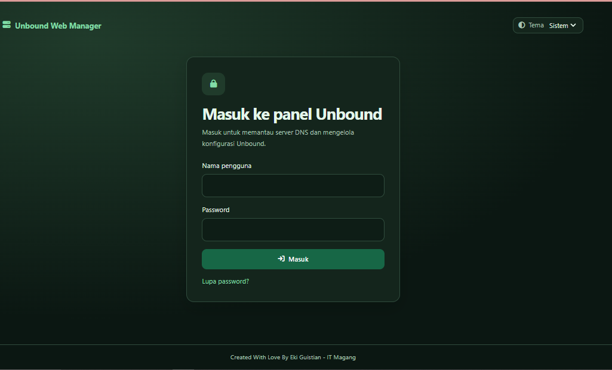
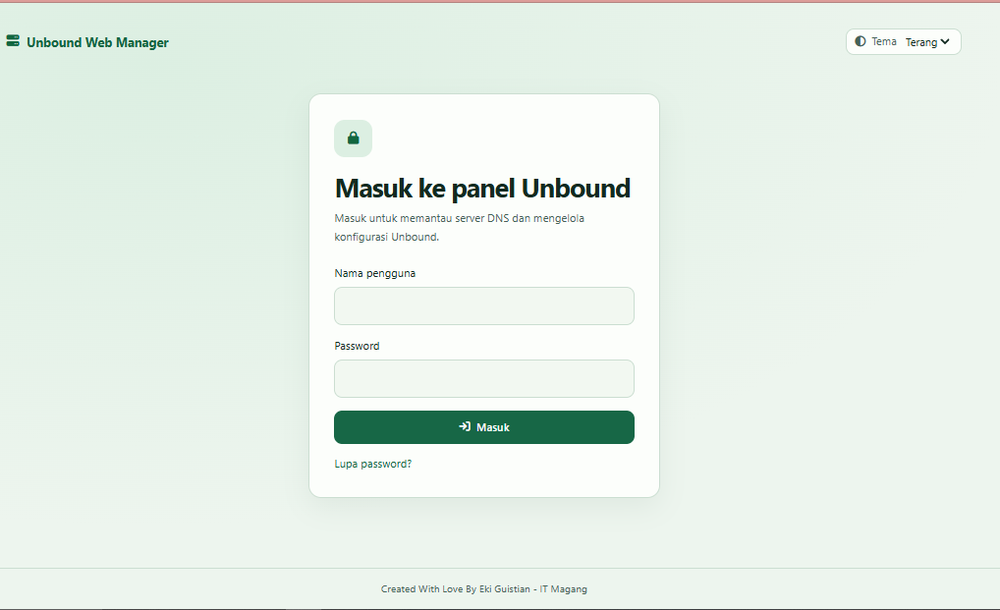
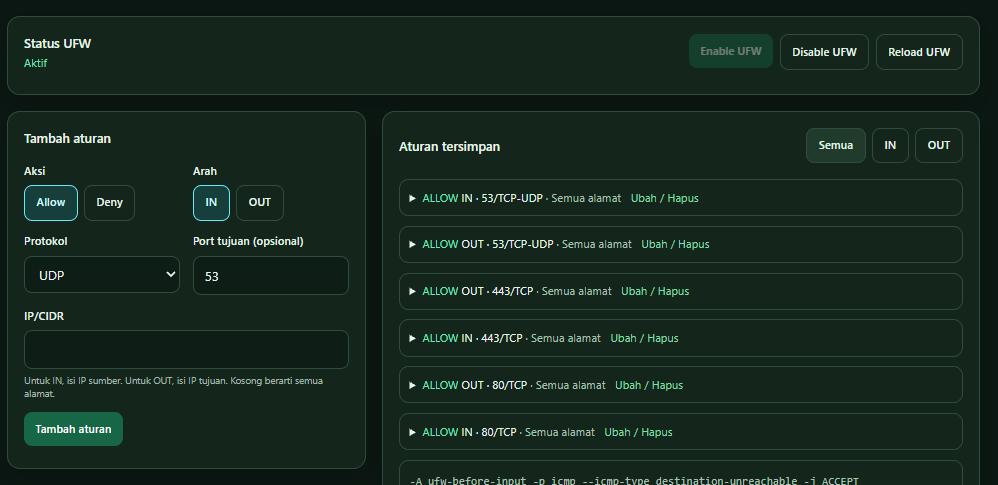

# Unbound Web Manager

## Minimum Server :
- OS : Ubuntu Server 22.04 LTS (jammy)
- CPU : 4 Core / 4vCore
- Ram : 4GiB
- Disk : 40Gib

Panel HTTPS untuk monitor dan kontrol Unbound di Ubuntu Server 22.04 LTS. Login diperlukan untuk membuka panel.

[Instalasi](#instalasi-awal) · [Pembaruan](#pembaruan) · [Fitur](#fitur) · [Blocklist dan Whitelist](#blocklist-dan-whitelist) · [Screenshot](#screenshot) · [Dukungan](#dukungan)

## Instalasi awal

### Dependensi

- **Server.** Ubuntu 22.04 LTS dengan systemd, akses `sudo`, Unbound, serta koneksi ke APT dan GitHub.
- **Dipasang oleh installer.** Nginx, MySQL 8, PHP 8.4 CLI/FPM dengan PDO MySQL, OpenSSL, dan Argon2id, serta Git, Python 3, curl, rsync, cron, iproute2, dan dnsperf. Installer menambahkan PPA Ondřej jika PHP 8.4 belum tersedia.
- **Opsional.** `unbound-anchor` untuk DNSSEC, UFW untuk Firewall, dan Zabbix Agent atau Agent 2 untuk ekspor metrik.

### Siapkan Unbound

```bash
sudo apt update &&
sudo apt install -y git unbound &&
sudo systemctl enable --now unbound &&
sudo unbound-checkconf /etc/unbound/unbound.conf
```

Gunakan [unbound.conf.example](unbound.conf.example) sebagai acuan. Sesuaikan IP, ACL, dan ukuran cache dengan server. Periksa file root hints, trust anchor, dan sertifikat kontrol yang dirujuk contoh sebelum menggunakannya. Aktifkan `remote-control` lokal agar panel bisa membaca statistik DNS.

### Pasang panel web

```bash
cd ~ &&
git clone --branch main https://github.com/ekiguistian/Unbound_DNS_Web-Manager.git &&
cd Unbound_DNS_Web-Manager &&
sudo bash ./install.sh
```

Masukkan email pemulihan saat diminta, lalu buka URL HTTPS dan login dengan akun awal yang ditampilkan. Untuk instalasi noninteraktif, isi `RECOVERY_EMAIL` melalui environment. Panel memakai TCP 443 dan sertifikat HTTPS self-signed. Gunakan `WEB_HOST` jika perlu menentukan alamat panel sendiri.

### Jika unduhan paket PHP gagal dengan HTTP 503

Jika PPA Ondřej mengembalikan `503 Service Unavailable` saat mengunduh paket PHP 8.4 dan installer berhenti dengan `exit 100`, jalankan kembali dari folder repo:

```bash
sudo apt-get update && sudo bash ./install.sh
```

Jika pesan `503` masih muncul, tunggu beberapa menit lalu ulangi perintah yang sama.

## Pembaruan

Panel menghitung versi dari riwayat utama `main` mulai **1.0.30**. Setiap commit baru di jalur itu menambah angka terakhir versi satu kali. MySQL menyimpan versi, hash lengkap, serta waktu pengecekan dan pemasangan.

### Lewat panel

Buka **Pembaruan → Cek pembaruan**, periksa versi dan hash, lalu pilih **Pasang pembaruan**. Panel mengambil commit dari GitHub ke `/opt/www/unbound-web/.updates/` dan menjalankan `update.sh` melalui systemd. Jika gagal, cek `sudo journalctl -u unbound-web-update -n 50`.

### Manual lewat terminal

Jalankan dari folder repo dengan riwayat Git lengkap.

```bash
cd ~/Unbound_DNS_Web-Manager &&
git switch main &&
git pull --ff-only origin main &&
sudo bash ./update.sh
```

Pembaruan berjalan tanpa meminta email. Setelah migrasi pertama, masuk lagi dengan username dan password lama, lalu isi email pemulihan dari menu **Akun** jika belum ada.

## Fitur

| Menu | Fungsi |
|---|---|
| **Monitor** | QPS, cache, latensi, CPU, RAM, disk, dan RX/TX. Dashboard diperbarui per detik dengan riwayat 10 menit. |
| **Unbound** | Cek, simpan, reload, start/stop, root hints, DNSSEC, dan sertifikat TLS remote-control. Perubahan konfigurasi yang berhasil disimpan ke file dan database. |
| **Interface & Reverse DNS** | Baca interface, zona reverse, dan record PTR yang ditulis di bagian `server:` pada `/etc/unbound/unbound.conf`. Loopback hanya bisa dibaca. IP lain bisa diedit per interface. Perubahan IP me-restart Unbound, sementara perubahan zona dan PTR memakai reload saat layanan aktif. Data tersimpan ke database. |
| **Log langsung** | Baca 40 entri journal terakhir dan ikuti log baru. Pencatatan kueri dan jawaban diatur terpisah. Gunakan **Hentikan log** untuk menutup sesi. |
| **Jadwal / Uji DNS** | Lihat status pemantauan dan jadwal filter. Jalankan satu tes dnsperf dalam satu waktu ke IPv4 privat atau loopback, maksimal 16 klien, 4 thread, dan 1.000 QPS. |
| **Zabbix Agent** | Edit konfigurasi agen atau aktifkan item `unbound.web.metrics` untuk total query, total reply, QPS, dan metrik Linux. Lihat [panduan item dan grafik Zabbix](docs/zabbix.md). |
| **Firewall** | Kelola rule, status, dan reload UFW. |
| **Akun** | Ubah nama pengguna, password, dan email pemulihan. Atur SMTP, tes pengiriman, dan gunakan OTP untuk pemulihan password. |

Tema **Sistem** mengikuti OS. Pilih **Terang** atau **Gelap** untuk menyimpan pilihan di browser.

### Akun dan pemulihan

Password baru harus 4–12 karakter. Di menu **Akun**, simpan email pemulihan dan pengaturan SMTP. Gunakan **STARTTLS** atau **SSL/TLS** untuk SMTP dengan autentikasi. Mode **None** mendukung relay tanpa autentikasi. Klik **Tes SMTP** untuk mengirim pesan tes ke email pemulihan.

Dari halaman masuk, pilih **Lupa password** dan masukkan email pemulihan. Masukkan kode OTP dari email pada browser yang sama dalam 10 menit.

## Blocklist dan Whitelist

### Tambahkan sumber

1. Buka **Unbound → Blocklist & Whitelist**.
2. Di **Sumber blocklist**, isi nama dan URL HTTPS publik. Sumber mendukung daftar domain, hosts, URL, Adblock, CSV, dan JSON.
3. Isi **URL sumber whitelist** untuk daftar pengecualian dari URL, atau masukkan domain secara langsung di **Whitelist manual**.

### Aktifkan dan sinkronkan filter

Pilih **Aktifkan Blocklist** atau **Aktifkan Whitelist**. Panel menambahkan include untuk filter yang dipilih di bagian `server:` pada `/etc/unbound/unbound.conf`.

```conf
    include: "/etc/unbound/blocklist/blocklist.conf"
    include: "/etc/unbound/blocklist/whitelist.conf"
```

Klik **Sinkronkan sekarang** untuk menerapkan perubahan sumber. Filter aktif juga disinkronkan setiap hari pukul 03.15 waktu server. Tombol **Nonaktifkan** menghapus include untuk filter terkait.

### Contoh URL sumber

**Whitelist** · [Buka daftar domain Eki Guistian](https://raw.githubusercontent.com/ekiguistian/whitelist-host/refs/heads/main/whitelist-domain.txt)

```text
https://raw.githubusercontent.com/ekiguistian/whitelist-host/refs/heads/main/whitelist-domain.txt
```

**Blocklist** · [Buka daftar hosts StevenBlack](https://raw.githubusercontent.com/StevenBlack/hosts/master/alternates/fakenews-gambling-porn-social-only/hosts)

```text
https://raw.githubusercontent.com/StevenBlack/hosts/master/alternates/fakenews-gambling-porn-social-only/hosts
```

Hasil konversi ada di `/var/lib/unbound-web-filters/`. Log ada di `/var/log/unbound-web-filters.log`. Untuk daftar jutaan domain, sediakan RAM tambahan saat validasi dan reload.

## Screenshot
<table>
  <tr>
    <th scope="col">Login · Gelap</th>
    <th scope="col">Login · Terang</th>
  </tr>
  <tr>
    <td><a href="docs/screenshots/login-gelap.png"></a></td>
    <td><a href="docs/screenshots/login-terang.png"></a></td>
  </tr>
  <tr>
    <th scope="col">Monitor · Gelap</th>
    <th scope="col">Monitor · Terang</th>
  </tr>
  <tr>
    <td><a href="docs/screenshots/monitoring-dns.png"></a></td>
    <td><a href="docs/screenshots/monitoring-dns-terang.png"></a></td>
  </tr>
  <tr>
    <th scope="col">Kontrol Unbound</th>
    <th scope="col">Zabbix Agent</th>
  </tr>
  <tr>
    <td><a href="docs/screenshots/kontrol-unbound.png"></a></td>
    <td><a href="docs/screenshots/zabbix-agent.png"></a></td>
  </tr>
  <tr>
    <th scope="col">Firewall UFW</th>
    <th scope="col">Pembaruan panel</th>
  </tr>
  <tr>
    <td><a href="docs/screenshots/firewall-ufw.png"></a></td>
    <td><a href="docs/screenshots/pembaruan.png"></a></td>
  </tr>
</table>

<a id="dukungan"></a>

## Dukungan anda berarti bagi saya untuk mengembangkan dan menemukan lebih banyak inspirasi.

[Traktir Eki Segelas Kopi](https://app.midtrans.com/payment-links/b45ec2c9-80f7-4dd8-b2e9-e18d430d192e-7l5NTR4t)

<a href="https://app.midtrans.com/payment-links/b45ec2c9-80f7-4dd8-b2e9-e18d430d192e-7l5NTR4t">
  
</a>

## Distribusi dan pengembangan

- Baca panduan pengembangan dan cara mengirim perubahan. [CONTRIBUTING.md](CONTRIBUTING.md)
- Batasi akses panel ke jaringan admin atau VPN dan izinkan kueri DNS dari subnet klien. Panduan produksi dan pelaporan kerentanan tersedia di [SECURITY.md](SECURITY.md).

### Atribusi

System ini di buat dan hasil ide oleh Eki Guistian, Anda boleh memakai dan memodifikasi dengan syarat tetap membuka code ke public dan mencatumkan sumber dari Eki guistian. sesuai aturan opensource. Ketentuan lisensi repositori tercantum di [LICENSE](LICENSE), dan lisensi komponen eksternal tercantum di [THIRD-PARTY.txt](public/assets/THIRD-PARTY.txt).
