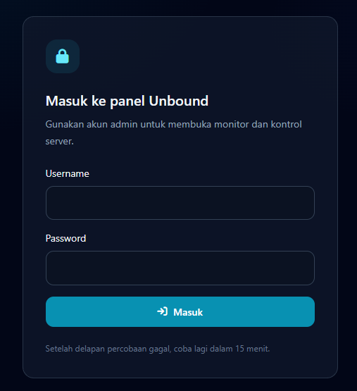
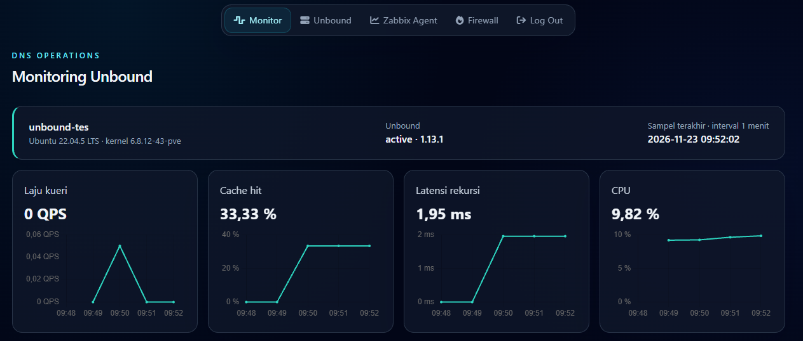
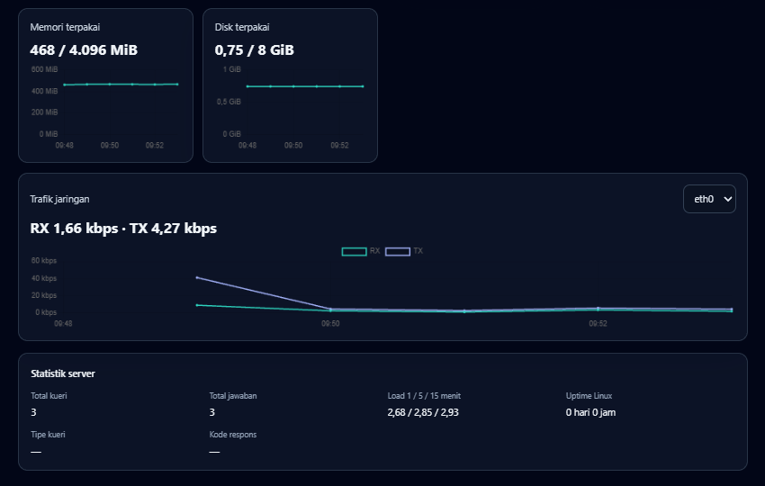
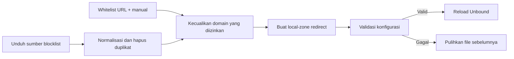
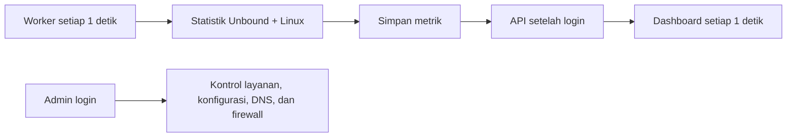

# Unbound Web Manager

Panel untuk monitoring dan kontrol Unbound di Ubuntu Server. Login diperlukan untuk membuka dashboard dan semua menu management.

## Tampilan web app







Contoh tampilan panel. Versi sekarang mengambil data dan memperbarui dashboard setiap **1 detik**.

## Persiapan server

Gunakan Ubuntu Server 22.04 LTS dengan systemd dan akses `sudo`. Untuk server baru yang belum punya Unbound:

```bash
sudo apt update &&
sudo apt install -y ca-certificates software-properties-common &&
sudo add-apt-repository -y universe &&
sudo apt update &&
sudo apt upgrade -y &&
sudo apt install -y curl htop git unbound ufw iftop
```

Aktifkan Unbound dan cek konfigurasinya:

```bash
sudo systemctl enable --now unbound
sudo unbound-checkconf /etc/unbound/unbound.conf
sudo unbound-control -c /etc/unbound/unbound.conf stats_noreset
```

Jika statistik belum tersedia, aktifkan `remote-control` lokal di konfigurasi Unbound. Contoh konfigurasi ada di [unbound.conf.example](unbound.conf.example); sesuaikan IP dan kapasitas cache dengan server.

Cek systemd dengan `ps -p 1 -o comm=`. Untuk WSL 2, lihat [panduan mengaktifkan systemd](https://learn.microsoft.com/en-us/windows/wsl/wsl-config#systemd-support).

## Install web app

Jalankan di server Unbound:

```bash
cd ~ &&
git clone --branch main https://github.com/ekiguistian/Unbound_DNS_Web-Manager.git &&
cd Unbound_DNS_Web-Manager &&
sudo bash ./install.sh
```

Installer menyiapkan MySQL, PHP 8.4, Nginx, HTTPS, database, dan layanan monitoring. Aplikasi dipasang ke `/opt/www/unbound-web/`. Konfigurasi utama Unbound yang sudah ada tetap dibaca dari `/etc/unbound/unbound.conf`.

Setelah selesai, terminal menampilkan URL, username, dan password login. Buka URL tersebut lalu masuk ke panel. Sertifikat awal self-signed, jadi browser dapat menampilkan peringatan sertifikat.

Jika ingin memakai IP atau nama DNS tertentu, jalankan dari folder proyek:

```bash
sudo env WEB_HOST=10.10.10.10 bash ./install.sh
```

Ganti alamat tersebut dengan IP atau nama DNS server. Pastikan TCP 443 dapat diakses dari komputer admin.

## Update dari main

Gunakan folder hasil clone. Simpan perubahan lokal terlebih dahulu jika ada.

```bash
cd ~/Unbound_DNS_Web-Manager &&
git switch main &&
git pull --ff-only origin main &&
sudo bash ./install.sh
```

Installer menerapkan source terbaru, migrasi database, dan pengaturan layanan. Akun login dan alamat panel yang sudah ada tetap dipakai. Setelah update, muat ulang halaman browser.

## Blocklist dan whitelist

1. Buka **Unbound → Blocklist & whitelist**. Delapan sumber dari TrustPositif dan StevenBlack sudah disiapkan. Pilih sumber yang ingin diaktifkan; sumber tetap bisa ditambah, diubah, atau dihapus.
2. Isi URL whitelist otomatis dan **IP redirect**. Nilai awal memakai [whitelist-host](https://raw.githubusercontent.com/ekiguistian/whitelist-host/refs/heads/main/whitelist-domain.txt) dan IP privat `192.168.1.2`. Ganti IP redirect sesuai server tujuan di jaringanmu.
3. Tambahkan pengecualian di **Whitelist manual**. Daftar ini tetap tersimpan dan digabung dengan whitelist URL saat sinkronisasi. Kosongkan URL jika hanya ingin memakai daftar manual.
4. Centang filter yang dibutuhkan, lalu pilih **Terapkan & perbarui cron**. Update otomatis berjalan pukul **03.15 waktu server**. Untuk menjalankan langsung, pilih **Update & Apply Now**.

Format sumber yang didukung: domain biasa, hosts, URL, Adblock, CSV, dan JSON. Blocklist dinormalisasi dan dideduplikasi. Whitelist mengecualikan domain beserta subdomainnya; penulisan `www.` pada whitelist tetap dipertahankan.

Daftar jutaan domain membutuhkan RAM untuk resolver dan validasi. VM 2 GB tidak cukup untuk gabungan seluruh sumber bawaan.

Hasil filter ditulis ke `/etc/unbound/blocklist/blocklist.conf`. Jika konfigurasi sudah meng-include file itu di dalam `server:`, panel langsung memakainya. Untuk konfigurasi yang memakai folder `unbound.conf.d`, panel membuat file include miliknya sendiri. Jika keduanya belum ada, tambahkan baris ini lewat editor Unbound:

```conf
include-toplevel: "/etc/unbound/unbound.conf.d/*.conf"
```

Panel memvalidasi konfigurasi sebelum reload. Unduhan atau penerapan yang gagal mempertahankan filter sebelumnya. Saat kedua filter dimatikan, aturan panel dikosongkan dan cron autoupdate dilepas.

Jika sebelumnya memakai `autoupdate-blocklist.py`, nonaktifkan jadwal script lama agar tidak menulis file yang sama. Hasil pemrosesan tersimpan di `/var/lib/unbound-web-filters/` dan log di `/var/log/unbound-web-filters.log`.



## Monitoring dan kontrol

| Menu | Fungsi |
|---|---|
| **Monitor** | QPS, cache hit, latensi, CPU, memori, disk, RX/TX, uptime, dan informasi Linux. |
| **Unbound** | Statistik, reload, restart, dan editor konfigurasi dengan validasi. |
| **Blocklist & whitelist** | Kelola sumber, pengecualian domain, redirect, dan autoupdate. |
| **Cron** | Status layanan monitoring dan jadwal filter. |
| **Uji DNS** | Uji resolver dengan dnsperf dan lihat QPS serta latensi. |
| **Zabbix Agent** | Edit konfigurasi dan muat ulang agent yang sudah terpasang. |
| **Firewall** | Tambah, edit, hapus rule UFW; enable, disable, dan reload. |

Monitoring memakai `unbound-web-monitor.service` dengan interval **1 detik**, termasuk saat filter DNS dimatikan. Dashboard menampilkan riwayat satu jam: dua menit terbaru per detik, sisanya per menit. Data lama disimpan per menit hingga 30 hari. Jika server sedang lambat, waktu sampel menunjukkan keterlambatan sebenarnya.

Satuan: QPS untuk kueri/detik, ms untuk latensi, persen untuk CPU/cache hit, MiB untuk memori, dan GiB untuk disk. RX/TX memakai kbps di bawah 1.000 kbps dan Mbps mulai 1.000 kbps.



## Cek saat ada masalah

```bash
sudo nginx -t
systemctl status unbound php8.4-fpm nginx unbound-web-monitor
sudo journalctl -u unbound-web-monitor -u php8.4-fpm -n 50 --no-pager
sudo tail -n 30 /var/log/unbound-web-filters.log
```

Untuk error `Read-only file system` atau `is not writable` saat memakai blocklist, editor Unbound, atau UFW, jalankan langkah **Update dari main** sampai `install.sh` selesai. Installer memperbarui helper kontrol dan akses layanan PHP-FPM. Jika APT sedang terkunci oleh update otomatis Ubuntu, tunggu selesai lalu ulangi installer.
