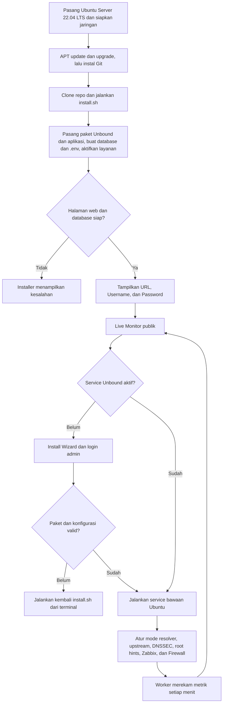

# Unbound DNS Web Manager

Pasang dan kelola resolver DNS Unbound dari browser. Web Manager menyediakan wizard instalasi, pengaturan resolver, monitoring, dan pengelolaan firewall untuk **Ubuntu Server 22.04 LTS (Jammy)**.

## Persyaratan

- Ubuntu Server 22.04 LTS di VM, server fisik, atau LXC Proxmox. Arsitektur amd64 atau arm64 dengan systemd aktif.
- Minimal 1 vCPU, RAM 2 GB, dan ruang kosong 4 GB pada filesystem yang memuat `/var`.
- Akun dengan akses sudo atau root, koneksi Internet, dan port TCP 8000 yang tersedia.
- MySQL berjalan di server yang sama. Installer memasangnya jika belum tersedia.

Installer memasang paket Unbound Ubuntu, Nginx, PHP 8.4 dan ekstensi aplikasi, MySQL, UFW, cron, logrotate, serta dnsperf. Service Unbound tetap memakai unit dan binary bawaan paket Ubuntu. [Repository PHP Surý](https://packages.sury.org/php/README.txt) · [Paket MySQL Ubuntu Jammy](https://packages.ubuntu.com/jammy/mysql-server) · [Dokumentasi resmi Unbound](https://unbound.docs.nlnetlabs.nl/en/latest/)

## Instalasi dari OS kosong

### 1. Pasang Ubuntu Server 22.04 LTS

Untuk VM atau server fisik, boot dari ISO Jammy dan siapkan akun serta jaringan. Untuk LXC Proxmox, buat container dari template Ubuntu 22.04, lalu atur IP, gateway, dan DNS di Proxmox. Masuk ke Ubuntu dan catat IP yang dapat dijangkau komputer admin. [ISO amd64](https://releases.ubuntu.com/jammy/) · [ISO arm64](https://cdimage.ubuntu.com/ubuntu/releases/jammy/release/) · [Panduan instalasi Ubuntu Server](https://ubuntu.com/server/docs/tutorial/basic-installation/)

```bash
. /etc/os-release
printf '%s (%s)\n' "$PRETTY_NAME" "$VERSION_CODENAME"
hostname -I
```

Pastikan hasil menunjukkan Ubuntu 22.04 LTS dengan codename `jammy`. Untuk resolver yang akan dipakai klien LAN, gunakan IP tetap atau reservasi DHCP.

### 2. Perbarui paket dan pasang Git

Jalankan perintah berikut sebelum clone. Jika masuk sebagai root, jalankan tanpa `sudo`.

```bash
sudo apt update
sudo apt upgrade -y
sudo apt install -y git ca-certificates
```

Jika Ubuntu meminta reboot setelah upgrade, reboot dan masuk kembali sebelum melanjutkan.

### 3. Clone dan jalankan installer web

```bash
git clone https://github.com/ekiguistian/Interaktif_Install-Unbound.git
cd Interaktif_Install-Unbound
sudo bash ./install.sh
```

Installer menyiapkan database, akun MySQL lokal, akun admin, dan `/etc/unbound-web/.env` secara otomatis. Installer mendeteksi IP dan interface jaringan, mengatur Nginx di port 8000, dan mengaktifkan layanan yang dibutuhkan. Kredensial yang sudah ada dipakai kembali saat installer dijalankan ulang.

Setelah pemeriksaan halaman dan koneksi database lulus, terminal menampilkan:

```text
URL      : http://192.168.1.2:8000
Username : admin
Password : <password admin yang dibuat installer>
```

Gunakan URL yang dicetak installer. Simpan username dan password admin dengan aman.

### 4. Periksa Unbound dari browser

1. Buka URL Web Manager. Jika status Unbound sudah `active`, lanjutkan langsung ke **Setting**.
2. Jika service belum aktif, pilih **Install Wizard**, login sebagai admin, lalu jalankan dua tahap secara berurutan. Wizard memeriksa tool paket dan konfigurasi, kemudian menjalankan service bawaan Ubuntu. Jika paket belum lengkap, jalankan kembali `install.sh`; wizard tidak memasang atau mengompilasi Unbound.
3. Setelah tahap terakhir berhasil, buka kembali **Live Monitor**. Menu berubah menjadi **Setting** dan worker mencatat data setiap menit.

### 5. Periksa DNS dari server

```bash
systemctl is-active nginx php8.4-fpm mysql cron unbound
curl -fsS http://127.0.0.1:8000/api/metrics
dig @127.0.0.1 nlnetlabs.nl A
```

Service harus berstatus `active`, API harus mengembalikan `"ok":true`, dan hasil `dig` harus menampilkan `NOERROR`.

Wizard mempertahankan `/etc/resolv.conf` pada VM dan LXC. Unbound dapat langsung diuji di `127.0.0.1:53`.

### 6. Atur mode resolver, DNSSEC, dan root hints

Buka **Setting → Unbound**. Pilih **Root langsung**, **Forwarder saja**, atau **Forwarder lalu Root**. Mode forwarder menerima hingga delapan alamat upstream IPv4 atau IPv6. Aktifkan DNSSEC dan file root hints InterNIC bila diperlukan, simpan konfigurasi, lalu pilih **Verifikasi DNS & resolver**. Pemeriksaan DNSSEC juga memastikan flag `ad` tersedia ketika DNSSEC aktif.

### 7. Atur IP DNS setelah instalasi

Buka **Setting → Unbound → DNS sistem** untuk mengganti atau menambah hingga tiga alamat DNS yang dipakai Ubuntu. Isi satu IP per baris. Masukkan `127.0.0.1` jika ingin Ubuntu memakai Unbound lokal. Jika file hanya bisa dibaca atau dipasang oleh host, alamat ditampilkan dalam mode baca saja. Ubah DNS melalui Proxmox atau pengelola host.

### 8. Hubungkan klien LAN dan monitoring bila diperlukan

1. Untuk melayani klien LAN, buka **Setting → Unbound**. Tambahkan IP LAN server, misalnya `192.168.1.2`, dan subnet klien, misalnya `192.168.1.0/24`, sambil mempertahankan interface dan ACL loopback. Validasi dan terapkan konfigurasi.
2. Jika memakai UFW, buka **Firewall**. Pastikan akses SSH dan TCP 8000 dari jaringan admin tersedia. Tambahkan **Allow IN** untuk TCP dan UDP port 53 dari subnet klien. Jika LXC tidak punya akses netfilter, buat aturan tersebut di firewall Proxmox atau host.
3. Dari klien yang diizinkan, jalankan `dig @192.168.1.2 nlnetlabs.nl` dengan IP server yang sebenarnya. Jika berhasil, pakai IP itu sebagai DNS klien atau bagikan melalui DHCP.
4. Untuk monitoring Zabbix, buka menu **Zabbix Agent**, isi alamat server dan hostname, lalu pasang dan periksa status agent.

## Alur sistem



## Fitur

| Menu | Fungsi |
| --- | --- |
| **Live Monitor** | Status dan versi Unbound, status Zabbix, query dan reply, QPS, cache hit, tipe query, kode respons, waktu rekursi, trafik jaringan, CPU, RAM, disk, dan uptime. Grafik menampilkan data satu jam terakhir. |
| **Install Wizard** | Periksa paket dan konfigurasi Unbound, lalu jalankan service bawaan Ubuntu. Pemasangan paket tetap ditangani `install.sh`. |
| **Unbound** | Atur interface DNS, ACL, cache, mode Root/Forwarder/Gabungan, upstream, DNSSEC, root hints, log, verifikasi resolver, baca `unbound.conf`, dan kelola DNS sistem. |
| **Blocklist dan Whitelist** | Kelola sumber HTTPS dan domain pengecualian. Mendukung format hosts, Adblock `\|\|domain^`, dan daftar domain biasa. Jalankan sinkronisasi langsung atau terjadwal. |
| **Cron dan uji DNS** | Jadwalkan pembaruan root hints atau blocklist. Kelola domain uji dan jalankan dnsperf ke IP lokal atau privat hingga 300 detik dengan pilihan client, thread, dan QPS. |
| **Zabbix Agent** | Pasang agent, atur `Server`, `ServerActive`, dan `Hostname`, lalu gunakan Enable, Disable, atau Restart. |
| **Firewall** | Lihat status UFW, aktifkan atau nonaktifkan firewall, serta tambah, ubah, dan hapus aturan Allow atau Deny untuk arah IN dan OUT. |
| **Check for Update** | Tarik dan terapkan branch `main` dari halaman Install Wizard atau Setting. |

Worker menyimpan riwayat hingga 30 hari. Log worker ada di `/var/log/unbound-web/worker.log` dan log sinkronisasi di `/var/log/unbound-web/blocklist.log`.

## Memperbarui Web Manager

`git clone` membuat salinan pertama repository dan cukup dijalankan sekali. Untuk memperbarui salinan yang sudah ada, masuk ke folder clone lalu jalankan:

```bash
git pull --ff-only origin main && sudo bash ./update.sh
```

`origin` adalah nama remote dan `main` adalah nama branch. `--ff-only` menghentikan pembaruan jika riwayat lokal sudah bercabang. Jika login sebagai root, jalankan tanpa `sudo`.

Untuk pembaruan berikutnya, login sebagai admin dan pilih **Check for Update** di **Install Wizard** atau **Setting**. Tombol ini menjalankan updater yang sama seperti di terminal.

Jika menjalankan updater dari terminal pada instalasi aktif, pindah dahulu ke direktori yang tidak diganti oleh deployment:

```bash
cd /
sudo bash /opt/unbound-web/update.sh
```

Folder `/opt/unbound-web` adalah rilis aplikasi yang dipasang, bukan checkout Git untuk menjalankan `git pull`. Checkout updater dikelola otomatis di `/var/lib/unbound-web-updates/checkout`.

`install.sh` memasang Git dan menyiapkan checkout milik root di `/var/lib/unbound-web-updates/checkout`. `update.sh` menarik branch `main` ke checkout tersebut, menempatkan seluruh file yang dilacak Git di `/opt/unbound-web`, lalu mengganti helper di `/usr/local/sbin/unbound-web-manage`. Nginx menyajikan folder `/opt/unbound-web/public`. Updater memeriksa commit lewat Nginx dan memulihkan file aplikasi serta helper sebelumnya jika pemeriksaan gagal. Pembaruan menjaga database dan konfigurasi di `/etc`.

## Yang perlu diperhatikan

- **Port jaringan.** Pastikan TCP 8000 dapat dijangkau dari jaringan admin. Service Unbound membutuhkan port 53 pada alamat yang dikonfigurasi dan akses DNS keluar. LXC perlu systemd dan jaringan yang mengizinkan layanan di dalam container.
- **Akses SSH.** Sebelum mengaktifkan UFW, pastikan aturan SSH dan port web sudah benar. Pada aturan IN, IP/CIDR adalah sumber. Pada aturan OUT, IP/CIDR adalah tujuan. Aturan lanjutan tampil dalam mode baca saja. Periksa urutan aturan setelah mengubah port, arah, protokol, atau alamat karena aturan pengganti ditambahkan di akhir.
- **Pemeriksaan awal.** Jika halaman gagal dibuka, periksa `sudo nginx -t`, `sudo systemctl status nginx php8.4-fpm mysql`, dan hasil `curl -fsS http://127.0.0.1:8000/api/metrics` dari server.
- **Aset browser.** Browser mengambil Tailwind CSS, Font Awesome, dan Chart.js dari CDN. Tampilan lengkap dan grafik memerlukan akses CDN.

### APT menampilkan `EXPKEYSIG` untuk MySQL

Jika percobaan lama meninggalkan repository MySQL Oracle, jalankan installer terbaru langsung dari folder repo. Installer menangani entri lama sebelum menjalankan APT.

```bash
sudo bash ./install.sh
```

Jika MySQL Community belum terpasang, installer mencadangkan entri lama dan memakai paket MySQL Ubuntu. Jika MySQL Community masih digunakan, installer memverifikasi dan memperbarui keyring Oracle sambil mempertahankan database. Verifikasi tanda tangan APT tetap aktif. [Panduan APT MySQL](https://dev.mysql.com/doc/mysql-apt-repo-quick-guide/en/)

## Keamanan

- Batasi port 8000 ke jaringan admin atau VPN. Gunakan reverse proxy HTTPS jika aplikasi diakses melalui jaringan yang tidak tepercaya. Dashboard publik menampilkan metrik kepada siapa pun yang dapat menjangkau port aplikasi.
- Jaga izin `0640` pada `/etc/unbound-web/.env` dan simpan output kredensial secara privat. Ubah kredensial admin melalui file ini. Aplikasi membatasi percobaan login dan memakai token CSRF untuk aksi admin.
- Batasi ACL DNS ke jaringan klien yang diizinkan. Log query dan reply dapat memuat alamat klien dan domain yang diminta.
- Helper sistem membatasi aksi sudo aplikasi pada operasi yang didukung. Konfigurasi Unbound diperiksa sebelum reload. Unduhan blocklist menggunakan HTTPS dan alamat publik yang tervalidasi.
- Laporkan masalah keamanan secara privat melalui kanal yang tercantum dalam [kebijakan keamanan](SECURITY.md).

## Kontribusi

Buka [issue](https://github.com/ekiguistian/Interaktif_Install-Unbound/issues) untuk laporan bug atau usulan. Sertakan versi Ubuntu, tahap yang gagal, langkah reproduksi, dan log yang sudah disamarkan. Gunakan pull request untuk perubahan kode atau dokumentasi. Panduan pemeriksaan tersedia di [CONTRIBUTING.md](CONTRIBUTING.md).

## Donasi

Jika ingin mendukung pengembangan, hubungi [pengelola proyek](https://github.com/ekiguistian) untuk informasi donasi. Bantuan lewat laporan bug, pengujian, atau perbaikan dokumentasi juga diterima.
